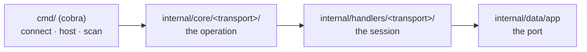

<p align="center">
  
</p>

<h1 align="center">
  cthrone
</h1>

<p align="center">A terminal chat tool that carries messages from one device to another, over a websocket or a NATS server.</p>

<p align="center">
  <a href="https://github.com/fiwon123/cthrone/actions/workflows/ci.go.yml"></a>
  
  <a href="https://github.com/fiwon123/cthrone/blob/main/LICENSE"></a>
</p>

---

## Table of contents

- [About](#about)
- [Security](#security)
- [How to use](#how-to-use)
- [Install](#install)
- [Commands](#commands)
- [Architecture](#architecture)
- [Repository](#repository)
- [How to develop](#how-to-develop)
- [Troubleshooting](#troubleshooting)
- [Tech stack](#tech-stack)
- [License](#license)

## About

cthrone is a chat tool for the terminal. One device hosts a chat server, any
number of devices connect to it, and everyone in the room sees what everyone
says — no account, no GUI, no configuration file.

There are three transports, and the command set is the same either way:

- **websocket** (the default) — one device runs the server, the other connects
  to it over the local network. Nothing else needs to be installed.
- **NATS** — both sides talk to a broker, so the two devices do not need to
  see each other directly. Useful when a broker is already running.
- **Bluetooth** — the two devices talk over the radio, so no network, router or
  broker is needed at all. It is the transport for a phone with no Wi-Fi, or two
  laptops on a network that isolates its clients. Linux and Windows, one device
  at a time, and built for text: a Bluetooth packet carries 20 bytes. A build
  that does not carry the transport — macOS, and a phone until the Android
  binding lands — does not offer the option at all. The Windows path compiles
  and **has never been run**: if it fails for you, that is a bug worth
  [reporting](https://github.com/fiwon123/cthrone/issues/215).

There is nothing to configure: the only setting is the port, and it comes from
the command line. The `ct` short alias ships next to the `cthrone` binary,
because a name you type many times a day should be short.

**Supported platforms**: Windows, Linux, macOS, and Android (arm64). On Android
there are two downloads: a **command-line program** that runs in a terminal app
on the phone, and an **APK** — the same chat with a touch-friendly GUI, which
installs like any other app. See [Android](#android) below.

> **Security**: every session is **end-to-end encrypted and authenticated** —
> a device that cannot prove its identity cannot join, and nothing it carries
> is readable by whatever sits in the middle, a broker included. Two devices
> pair on first contact by **device key**, with no value to copy: a
> **six-digit code** appears on both screens, the host accepts or refuses, and
> only then is the key pinned. A **shared secret** stays as the alternative for
> older peers. There is no anonymous mode. The websocket connection is encrypted as well (`wss://`) unless
> `--no-tls` is given, and the host's certificate is pinned on first contact.
> See [Security](#security) for how it works, and
> [issue #125](https://github.com/fiwon123/cthrone/issues/125) for the model.

> **Status**: actively used, pre-1.0, and not yet covered by tests — see
> [How to develop](#how-to-develop).

## Security

Every session is encrypted and authenticated, and one of two credentials does
the authenticating. Exactly one is used per session; the transport does not
decide which, and nothing falls back to plaintext.

| Credential | When it is used | What pairs the two devices |
|---|---|---|
| **device key** | the default — no secret is configured | nothing is copied: both screens show a **six-digit code**, the host accepts it, and each device pins the other's key |
| **shared secret** | `--token`, `CTHRONE_TOKEN`, or a file named with `--token-file` | the secret itself — every device holding it is the same identity, which is how a v0.6.0 peer still connects |

### Pairing by device key (the default)

The first time this device runs it generates an **ed25519 key** and keeps the
private half to itself: `~/.config/cthrone/identity.key`, `0600` — the app's
private storage on Android. It never leaves the device, and nothing generates a
value for you to copy.

> The paths here are the Linux ones. The tool asks the platform for its user
> configuration directory, so the key, the pins and the TLS material sit under
> `~/Library/Application Support/cthrone` on macOS and `%AppData%\cthrone` on
> Windows, in the same arrangement.

When two devices meet, each one signs its hello with that key. The peer checks
the signature and then **pins** the key beside the device's name in
`~/.config/cthrone/peers.json`. That is trust on first use: from then on, that
name has to come back with the same key. The pin is written only after the
exchange has proved the peer holds the key — a hello that is never answered
records nothing, so a stranger cannot claim a name and lock its owner out.

First contact is the only moment a machine in the middle could insert itself,
so each screen prints **both fingerprints**: the other device's — a short,
grouped form of the key's hash — and this device's own. The terminal and the
app say so explicitly. Compare them with the other screen: the value it calls
its own is the one this side calls the peer's, and the reverse. If either pair
differs, stop and forget the pin.

#### The six-digit code

A fingerprint is exact and hard to read aloud, so a first contact also shows a
**six-digit code** — `123 456` — on both screens, and the host asks before it
lets the device in:

```text
phone wants to connect.
Its fingerprint is 3f1a-9c02-77bd-5e44.
The code both screens show is 123 456 — they must agree.
Accept this device? [y/N]
```

- the code is derived from the two **ephemeral X25519 keys** of this handshake,
  so it exists only while the question does: it cannot be replayed into a later
  session, and it is not written anywhere;
- a machine in the middle terminates two handshakes, so each of its legs
  derives a different code — that is the point of comparing it. The
  fingerprints and the code close the same gap; compare both, and answer `n`
  if either differs;
- the host **withholds its confirm** until the answer is yes, so the client is
  not authenticated, and pins nothing, while the question is open. A refusal
  pins nothing on either side and leaves the client unpaired;
- an unanswered question expires after **60 seconds** and counts as a refusal:
  silence is not a yes;
- a device already pinned under its name is not asked again. The pin *is* the
  answer to that question, given once.

Only a **host** asks, and only where there is one: the websocket's and the
Bluetooth host's. A Bluetooth link also has exactly one correspondent, and the
host is the side with a screen to ask on — the code appears on both screens
there too. On NATS the roles are inverted — every peer subscribes — so nobody
is a host to ask, and a
first contact is pinned without a prompt, with the fingerprints on both screens
as the comparison. A terminal host that has **no terminal attached** — a
container, a service — has nobody to ask either: it accepts and pins the first
contact and prints why. Run it in a terminal to compare the code instead.

A device that returns with a **different key under a pinned name** is refused:
the session ends on a websocket, and on a NATS subject that peer is dropped
while the rest of the room stays up. Nothing is silently re-pinned. The way
back from a reinstall, or from a pairing made by mistake, is:

```bash
cthrone peers                     # what this device has pinned, and when
cthrone peers forget bob          # by name, or by the fingerprint it printed
cthrone peers forget 192.168.0.42 # a host whose certificate changed
```

A device with no `--name` is still pinned by a name — the hostname identity the
network scan already announces — so a changed key is refused rather than
looking like a new device.

### The shared secret (alternative)

A shared secret is one key that every device holding it knows. It says "this
peer may join", not "this is the same device as last time", so it keeps a pair
working and says little about a group. It stays for two reasons: a peer from
v0.6.0 speaks nothing else, and a set of devices can deliberately share one
value.

It is read from the first of these that has a value:

| Source | How |
|---|---|
| `--token` | the flag — **visible in the process list** to every other process on the machine, so it is for a quick manual run, not for daily use |
| `CTHRONE_TOKEN` | the environment — the one to use in a container or a script |
| the token file | `--token-file <path>` — **no file is read unless it is named here** |

`cthrone host` **no longer generates** a secret: a generated file would put
every later run on this machine into this mode, and a fresh device pairing by
key could then never join it. To use the secret path, supply a value of at
least 16 bytes yourself, or point at a token file copied from a v0.6.0 device
with `--token-file`.

A `~/.config/cthrone/token` left by v0.6.0 is **not read any more**: reading it
without being asked is what made an upgraded device ask a peer for a secret it
never chose. Both `cthrone host` and `cthrone connect` print a note naming that
file, `cthrone ui` says the same on its Setup tab and offers to delete it, and
`--token-file ~/.config/cthrone/token` puts it back in charge if that is what
you want. Nothing is deleted for you — the secret is yours.

With a secret configured the websocket client presents it in a header, and one
that does not is refused with a `401` before any session starts. It does two
jobs: it is the password that lets a device in, and it is the material both
devices derive their encryption keys from. A device that presents the wrong one
cannot complete the handshake, and the session ends with a message saying why.
There is no anonymous mode.

One flag changes the shape of it:

- `--host <address>` binds the server to one interface instead of every
  interface. The default is every interface, because the tool is a chat
  between two devices on the same network.

### Encryption

Every session is encrypted end to end, whatever the transport. Each pair of
devices runs a handshake when they meet — a X25519 key exchange, folded into a
per-direction key with HKDF — and every message after it travels as
AES-256-GCM ciphertext with a sequence number that makes a replayed or
reordered frame fail.

The handshake itself is authenticated by the credential: in the shared-secret
version by an HMAC computed with the secret, and in the device-key version by
the peer's signature over its half of the exchange plus the pairwise key. A
device that cannot produce the proof cannot make a session look encrypted, and
cannot read one. A peer that speaks the other version is refused rather than
downgraded.

That is what makes the NATS transport private: **the broker carries
ciphertext**. It sees that two devices are talking on a subject and nothing
about what they say. Over a websocket the host is your correspondent rather
than a relay, so the end-to-end layer protects the wire, not the peer. On
Bluetooth the radio carries the sealed payloads too: what an observer nearby
can tell is how many packets moved and when, never what they said.

The websocket connection is **encrypted by default**: the host serves
`https`, and the client connects over `wss://`. Nothing has to be remembered —
start `host` on one device and `connect` on the other, and the connection is
sealed before the first message.

`--no-tls` turns that off: the host serves plaintext `ws://` and the client
expects it. It exists for a peer that still speaks v0.6.0, which has no `wss://`
path, and for a quick experiment on a network you trust. The payload stays
sealed end to end either way; what `--no-tls` exposes is the shape of the
conversation on the wire.

The host's certificate is **self-signed** — there is no certificate authority
for a chat between two devices on a LAN — so the client does not check it
against an authority. It is **pinned on first contact**, beside the device keys
in `~/.config/cthrone/peers.json`, under the address it dialed:

- the first certificate seen at an address is recorded;
- every later contact has to present the same one, and a different certificate
  at the same address is refused with the fingerprint it got;
- `cthrone peers` lists those pins too, and `cthrone peers forget <address>`
  is the way back — for a host that reinstalled, or for a certificate rotated
  on purpose. The next contact pins the new certificate.

First contact is therefore the one moment a machine in the middle could insert
itself, exactly as with the device key. The two pins stand behind each other:
the certificate keeps a passive listener from seeing the shape of the traffic,
and the session still needs a device key the peer accepts.

The host generates the certificate the first time it runs and keeps it —
`~/.config/cthrone/cert.pem` and `~/.config/cthrone/key.pem` (the key is
`0600`) — so the pin does not change under a client that recorded it. It prints
the fingerprint on start; nothing needs to be typed from it.

`--cert-fingerprint <hex>` pins the certificate **by hand** instead, for a
script or a device that should not record the first one it sees. The
fingerprint is accepted with or without colons in it, and a certificate that
does not match is refused with the one that arrived.

`--insecure` makes the client accept **any** certificate. The traffic is
still encrypted; the host is simply not checked, which means anyone who can
intercept the connection can present their own. It is for a trusted network,
and it has to be asked for.

With `--no-tls` the connection itself is not encrypted: what is said is
sealed, but who is talking to whom, and how much, is visible on the wire.

## How to use

1. Install the binary (see [Install](#install)), or run it from source with
   `go run ./ --help`.

2. On the device that receives the messages, start the chat server:

   ```bash
   cthrone host
   ```

   It listens on port 8080 and prints a line when a client connects. The
   first time it runs it also **generates a device key** for itself
   (`~/.config/cthrone/identity.key`, 0600). Nobody copies it anywhere: the
   other device learns it on first contact.

3. On the other device, connect to it:

   ```bash
   cthrone connect 192.168.0.42
   ```

   The IP is the address of the machine running `host`. Everything you type is
   sent; everything the other side types is printed.

   The first time the two devices meet, each prints **both** fingerprints —
   the other device's and its own — and a **six-digit code**:

   ```text
   Encrypted with host — new device; its fingerprint is 3f1a-9c02-77bd-5e44, this device's is 8b21-77de-02a1-4c9f. Compare both with the other screen.
   First contact with host — code 428 715. Both screens must show the same code.
   ```

   The host asks before it lets the device in, with the same code:

   ```text
   phone wants to connect.
   Its fingerprint is 3f1a-9c02-77bd-5e44.
   The code both screens show is 428 715 — they must agree.
   Accept this device? [y/N]
   ```

   Compare the fingerprints, then the code with the other screen: the value it
   calls **its own** is the one this side calls **the other device's**, and the
   reverse. If either differs, answer `n` — nothing is pinned. If they agree,
   answer `y`: the device is pinned in `~/.config/cthrone/peers.json`, and a
   different key under the same name is refused from then on. An answer that
   never comes expires after 60 seconds and counts as a refusal. A device that
   only announces itself and never completes the exchange pins nothing.

   The shared secret still works if you have one — from a v0.6.0 device, or
   because you want several devices to share one value. Give both sides the
   same one:

   ```bash
   # a token file kept from v0.6.0 is read only where you point at it
   cthrone connect 192.168.0.42 --token-file ~/.config/cthrone/token
   ```

   and on the host `cthrone host --token-file ~/.config/cthrone/token`. The
   environment works the same way: `CTHRONE_TOKEN="$(cat <file>)"`.

   The connection is already encrypted (`wss://`), and the host's certificate
   was pinned on first contact, so there is nothing to copy. Only a v0.6.0
   peer — which speaks plaintext — needs `--no-tls` on both sides; see
   [Security](#security).

   A host is a **room**, not a pair: a third device joins with the same
   command, and a message from any device reaches every other device in it.
   What one device sends is printed once, on every screen, with its sender
   named — `alice (192.168.0.5): hello` — and the host relays it rather than
   keeping it. Files relay the same way; the sender's name travels in the
   frame's header, because a file has no line to prefix. On a device that is
   connected to a host the line reads `host: alice (192.168.0.5): hello`: the
   first name is the device it is connected to, the second is who spoke.

   The host's terminal is one console for the whole room, so its own line goes
   to every device and two devices never compete for the keyboard. A device
   that leaves does not end the host; Ctrl-C at the host does, and the port
   goes back to the machine.

4. Do not know the address? Scan the local subnet for a chat server:

   ```bash
   cthrone scan
   ```

   It walks the `/24` of the address your default route uses — the network the
   machine is actually on, not the first private address an adapter happens to
   list — and prints the addresses that answer on the chat port, each with the
   name the device announces: `laptop (192.168.1.20)`, or the address alone
   when its broadcasts do not reach you.

   A device on a **different** segment of the same network — a second Wi-Fi, a
   VLAN, a wired segment on another prefix — is found by naming that segment:

   ```bash
   cthrone scan --subnet 192.168.1.0/24
   cthrone scan --subnet 192.168.1.0/24 --subnet 10.0.0.0/24   # several
   cthrone scan --all-subnets                                  # every interface
   ```

   This works when the router **routes** between the two segments. It cannot
   cross a NAT (a second router behind the modem) or client isolation on the
   access point: those segments answer nothing, and the scan says so rather
   than claiming the network is empty. The device name comes from a broadcast
   that does not cross a subnet, so a host on another segment is printed by
   address alone.

5. Prefer a broker? Add `--nats` to either side, and run a NATS server
   locally — the repository ships one in `docker-compose.yml` for that:

   ```bash
   docker compose up -d nats
   cthrone host --nats
   ```

   The broker is published on `nats://127.0.0.1:4222` on the host, so a
   client running on the host reaches it. If the dev sandbox is already
   running, the broker is up with it — the sandbox declares the broker as
   a dependency, so `make dev-up` starts both.

   On the other side, `cthrone connect --nats` publishes to the broker.

   Note that on the NATS path the roles are inverted: `host` **subscribes** to
   the subject and `connect` **publishes** to it. The subject is the
   positional argument and defaults to `chat`:

   ```bash
   cthrone host --nats room-42
   cthrone connect --nats room-42
   ```

   The broker is the one the `--nats-url` flag names, and it defaults to
   `nats://127.0.0.1:4222` — so a remote broker is reachable:

   ```bash
   cthrone host --nats --nats-url nats://broker.internal:4222
   ```

   **The broker asks for credentials.** They come from the environment —
   `NATS_USER` and `NATS_PASSWORD` — and not from a flag, because a flag is
   visible in the process list:

   ```bash
   export NATS_USER=cthrone NATS_PASSWORD=cthrone-dev
   cthrone connect --nats
   ```

   The broker that ships with the dev sandbox uses the same names, with
   `cthrone` and `cthrone-dev` as the defaults. Override them for both
   sides when you want a different password:

   ```bash
   NATS_USER=cthrone NATS_PASSWORD=another-one docker compose up -d nats
   ```

   A broker that asks for no credentials is still reachable: without
   `NATS_USER` the client offers none.

   **The broker keeps nothing.** JetStream is off, so a conversation does
   not outlive the session it happened in, and the broker has no messages
   to clean up.

   **The broker cannot read the messages.** Every payload is sealed by the
   two devices before it is published — the pairwise keys come from the
   handshake, not from the broker — so it carries ciphertext: it can tell
   that something was sent on a subject, not what it said. On the device-key
   path the broker is told nothing about who the devices are; on the
   shared-secret path both devices hold the same value.

   **The connection to the broker can be encrypted** too: give the URL the
   `tls://` scheme and pin the broker's certificate with
   `--cert-fingerprint` (or skip the check with `--insecure`). The scheme
   decides here rather than a switch, the way a URL does.

   ```bash
   cthrone connect --nats --nats-url tls://broker.internal:4222 \
     --cert-fingerprint 1f2e3d...
   ```

6. No network at all? Put the two devices on Bluetooth. One hosts, the other
   connects; there is no address and no port, and the positional argument is a
   device name or address that narrows the search:

   ```bash
   cthrone host --bluetooth
   cthrone connect --bluetooth            # the first cthrone device in range
   cthrone connect --bluetooth phone      # by the name it advertises
   cthrone connect --bluetooth AA:BB:CC:DD:EE:FF
   ```

   `cthrone scan --bluetooth` lists the devices in range, by name and address.
   A host serves **one device at a time**: BlueZ does not say which central
   wrote to a characteristic, so two devices cannot be told apart, and the slot
   frees when the keepalive notices the device has gone quiet. Text is what the
   link is for — a 256 KiB file chunk is thousands of 20-byte packets. The
   transport speaks the platform's own stack — BlueZ over D-Bus on Linux, WinRT
   on Windows — and a build for macOS or Android says it has no Bluetooth
   transport instead of failing somewhere deeper. The Windows path compiles;
   nothing has run it. Pairing is unchanged: the same six-digit code on
   both screens, and the peer is pinned by its device key.

## Install

Download the archive for your platform from the
[releases page](https://github.com/fiwon123/cthrone/releases), then run the
installer it ships with — Linux, macOS and Windows carry one; the Android
archive does not. Every release also carries a `checksums.txt` — verify a
download before running it.

| Platform | Archive | Install |
|---|---|---|
| Linux (amd64) | `*_linux.tar.gz` | `tar -xzf <archive> && cd <folder> && ./add_to_path.sh` |
| macOS (Apple silicon) | `*_darwin_arm64.tar.gz` | `tar -xzf <archive> && cd <folder> && ./add_to_path.sh` |
| macOS (Intel) | `*_darwin_amd64.tar.gz` | same as above |
| Windows (amd64) | `*_windows.zip` | `Expand-Archive <archive>` then `.\add_to_path.bat` |
| Android (arm64), app | `*_android_gui_arm64.apk` | copy it to the phone and tap it, or `adb install <file>` — see [Android app](#android-app-arm64) |
| Android (arm64), CLI | `*_android.zip` / `.tar.gz` | **CLI, not an app** — runs in Termux; see [Android CLI](#android-cli-arm64-termux) |

The desktop GUI (`cthrone_gui`) ships as its own archive, so a terminal-only
user does not download a window toolkit:

| Platform | Archive | Notes |
|---|---|---|
| Linux (amd64) | `*_linux_gui_amd64.tar.gz` | needs the GTK3/GL/X11 runtime libraries, listed in the release notes |
| Windows (amd64) | `*_windows_gui_amd64.zip` | no extra runtime libraries |
| macOS (Apple silicon) | `*_darwin_gui_arm64.tar.gz` | no extra runtime libraries |

Each archive carries both `cthrone` and the short alias `ct`, so `ct host`
works the moment the folder is on your PATH.

The GUI archive adds `cthrone_gui` — the binary that opens the window — and, on
Linux, a menu entry the installer registers with a launcher icon it writes into
the XDG directories itself. No archive carries an icon file: the window icon is
embedded in `cthrone_gui`, and the launcher copy only exists once it is
installed.

### Android

Android gets two downloads from the same source tree: an **app** you tap, and
the **CLI** for a terminal app. Pick the app unless you want a terminal.

#### Android app (arm64)

`cthrone_<tag>_android_gui_arm64.apk` is the Fyne GUI compiled for a 64-bit ARM
phone or tablet — the same chat, with buttons instead of a prompt. It is
**debug-signed**, which is what a sideload accepts: there is no store listing
and no update channel, so a new release is a new APK installed over the old
one. Android asks permission to install from your browser or file manager the
first time.

```bash
adb install cthrone_<tag>_android_gui_arm64.apk
# or copy the file to the device and tap it
```

The app has four tabs:

- **Chat** — the conversation, a send field and a stop button. The field is a
  composer rather than a one-line prompt: **Enter starts a new line**, and a
  message is sent deliberately — with **Shift+Enter** on a desktop, or with the
  **Send** button on a phone, which has no Shift key and whose keyboard turns
  its action key into a newline. The field shows a few lines and then scrolls
  internally, so a paragraph does not push the conversation off the screen; a
  multi-line message travels as one message and keeps its line breaks. An
  arriving message is labelled with the device name and, on a websocket, the
  address it came from — `laptop (192.168.1.20:51234)` — because a name alone
  does not say which machine on the network it is. Tap a message to copy it —
  or hold it still for a moment to select part of it and get a **Copy** menu,
  the phone's gesture, because the drag belongs to the scrolling pane; on a
  desktop the drag selects, as it does everywhere. **Copy all** copies the whole
  conversation. Every message, status line and address is selectable text that
  way, and an error dialog carries a **Copy** button, so a failure can be
  pasted into a bug report instead of retyped from a screenshot.
- **Setup** — the port, the credential (device key by default, or a shared
  secret), the transport and the TLS options, with **Host** and **Connect**.
  The transport is WebSocket, NATS, or Bluetooth where the build carries it —
  Linux and Windows, one device at a time. macOS and a phone build offer the two
  network transports only: macOS has no backend in the library this uses, and
  Android needs its own binding (#206). Encryption is on unless the box is
  cleared, and the host's certificate is pinned on first contact.
- **Devices** — **Scan network** walks the `/24` the default route uses for a
  host on the chat port (with Bluetooth selected, the same button scans the
  radio); tap a result to fill in its address. A row reads
  `laptop — 192.168.1.20:8080` once the device has announced itself, and shows
  the address alone until then — the address is always there, never replaced by
  the name. A device that hosts
  is never listed in its own list — its address is shown read-only under
  **Setup** instead, as *This device — &lt;address&gt;:&lt;port&gt;*, limited to
  the addresses a peer on that network can reach.
- **About** — the build version, the repository link and a **Check for
  updates** button. When it finds a newer release it offers to **install** it:
  the download is checked against the release's own `checksums.txt` before
  anything is replaced, the binary it replaces is kept beside it, and
  **Revert to previous** puts that one back without a network call.

Any button or tab label can be copied with a **long press**; on a desktop the
same gesture is a right-click. A short **Copied** hint confirms it, and a
normal tap still does what the button is for. Text works the other way round:
a tap still does what it did, and the long press is what selects.

A phone that hosts shows **its own fingerprint** in a dialog. Nothing is copied
to the other device: connect to the phone and compare the fingerprints each
screen shows — that is the whole pairing. A first contact is also confirmed by
a **six-digit code**, shown on both screens: the host has a dialog with
**Accept** and **Refuse**, and the device that dialed waits with the same code
on screen. A phone that is given a shared secret
instead shows the secret, copied to the clipboard, and the other device needs
the same value. The app keeps its device key, its pins, the secret and its TLS
material in its own private app storage, because a phone has no user
configuration directory it can rely on. On a desktop the same code uses the
same directory as the CLI, so `cthrone host` in a terminal and `cthrone ui` on
one machine are one device with one key.

The app is an **Android** build today. The same Go code is the source for an
iOS build, which needs macOS and Xcode and has not been done yet
([issue #84](https://github.com/fiwon123/cthrone/issues/84)).

#### Android CLI (arm64, Termux)

The Android archive holds the same command-line program, compiled for Android's
CPU. Android has no terminal of its own, so it runs inside one —
[Termux](https://termux.dev) is the one it is written for.

```bash
# inside Termux
cd ~                       # not /sdcard — that mount is noexec, and running
                           # the binary from there fails with "Permission denied"
curl -LO https://github.com/fiwon123/cthrone/releases/download/<tag>/cthrone_<tag>_android.tar.gz
tar -xzf cthrone_<tag>_android.tar.gz
chmod +x cthrone ct
./cthrone connect <ip>     # or ./cthrone host — same commands as on a desktop
```

The terminal pairs the same way it does on a desktop: the first contact prints
the other device's fingerprint and a six-digit code on both screens, and no
file crosses between the two. `cthrone peers` lists and forgets what this
device has pinned.

What the Android CLI does and does not give you:

- **arm64, `v8.0` only** — a 32-bit phone and an x86_64 emulator cannot run it.
- the archive carries **no installer script** (Linux, macOS and Windows ship
  one); to type `cthrone` from any directory, add the folder to `PATH` yourself,
  e.g. `echo 'export PATH="$HOME/cthrone:$PATH"' >> ~/.bashrc` in Termux.
- the desktop GUI ships as `cthrone_gui` in its own archive; the APK above is
  the phone equivalent, and `cthrone ui` in this archive only prints a message.
- `--bluetooth` refuses on this build: the transport speaks the desktop stacks
  (BlueZ, WinRT), and Android has neither. A phone binding is a separate piece
  of work
  ([issue #206](https://github.com/fiwon123/cthrone/issues/206)); until it
  lands, use a network transport on the phone.
- **neither Android download is verified on a device.** Both are cross-compiled
  and published; nothing in this project's CI installs the APK or runs the
  binary on a phone or an emulator, so "built for Android" is a build claim, not
  an observed result. If it fails on your device,
  that is a bug worth
  [reporting](https://github.com/fiwon123/cthrone/issues) rather than a
  surprise.

### Keeping it up to date

`cthrone update --check` asks the public release list whether a newer version
exists. On a desktop the About tab's **Check for updates** does the same, and
when it finds one it offers to install it — so does
`cthrone update --install`, which takes `--to <tag>` to go to a version other
than the newest.

The install is deliberately conservative:

- the download is checked against the **`checksums.txt` the release publishes**
  before anything is replaced; a mismatch aborts and prints both hashes;
- the swap only ever publishes a fully written file, so nothing half-written is
  ever run. On Linux and macOS the replacement is one `rename`, which is atomic:
  an interrupted run leaves either the old binary or the new one. Windows cannot
  replace a running executable, so it renames the old one aside first and puts
  it back if the new one cannot be moved into place; cut short between those two
  steps, the binary is left as `<name>.old` beside `<name>.previous`, and the
  next install restores it;
- the binary it replaces is kept beside it as `<name>.previous`, and
  `cthrone update --revert` (or **Revert to previous** on the About tab) swaps
  it back with no network call. Reverting twice returns to where you started.

Only the binary that is running is replaced. The rest of the archive — the `ct`
alias, the window build, the docs — is left alone; unpack the archive for those.
Android is not covered by this: an APK is installed by the phone's own installer,
so the app links to the release page instead.

## Commands

| Command | What it does |
|---|---|
| `cthrone host` | host the room: every device that joins sees the messages of the others |
| `cthrone connect <ip>` | connect to a device's chat server and chat; with `--bluetooth`, the argument is a device name or address |
| `cthrone scan` | scan the default route's `/24` for chat servers; `--subnet <cidr>` adds another segment, `--all-subnets` walks every local interface (shows device names when discovered); `--bluetooth` lists the devices in radio range instead |
| `cthrone peers` | list the devices and host certificates this one has pinned, or `cthrone peers forget <name\|fingerprint\|address>` one |
| `cthrone ui` | same as `cthrone_gui` when built with `-tags gui`; the release CLI binaries only print a message — use the GUI archive's `cthrone_gui` |
| `cthrone recv` | opt-in remote command receiver with allowlist and audit logging |
| `cthrone exec <device> -- <cmd>` | run a command via an opt-in receiver (allowlist + logging enforced) |
| `cthrone update --check` | ask the public release list whether a newer version exists; names the archive for this platform and exits 0 either way — non-zero only when the check could not be made |
| `cthrone update --install [--to <tag>]` | replace this binary with the one from the newest published release, or the one named by `--to`; the download is verified against the release's `checksums.txt` first, and the binary it replaces is kept as `<name>.previous` |
| `cthrone update --revert` | put the previous binary back, without a network call |

| Flag | What it does |
|---|---|
| `-p`, `--port` | the port to use (default `8080`) |
| `--subnet` | `cthrone scan`: an IPv4 CIDR to walk as well, e.g. `192.168.1.0/24`; repeat for several segments |
| `--all-subnets` | `cthrone scan`: walk the `/24` of every local network interface |
| `--nats` | use the NATS transport instead of the websocket one |
| `--nats-url` | the NATS broker to connect to (default `nats://127.0.0.1:4222`); a `tls://` URL asks for an encrypted connection |
| `--bluetooth` | use the Bluetooth transport instead of the websocket one (Linux and Windows; `host` serves one device at a time) |
| `--token` | a shared secret to use instead of pairing by device key — **visible in the process list**, so prefer the environment or the file |
| `--token-file` | the file the shared secret is read from — no file is read unless it is named here |
| `--host` | the interface `cthrone host` binds to (default: every interface) |
| `--name` | device name shown to the peer in an encrypted session; the host also announces it on the network |
| `--no-tls` | serve and dial plaintext `ws://` instead of the default `wss://`; the payload stays sealed end to end |
| `--tls` | encrypt the transport — **the default**; kept so a v0.6.0 command line still runs |
| `--cert-fingerprint` | pin the certificate by hand instead of on first contact; a `tls://` broker needs one (or `--insecure`) |
| `--insecure` | accept any certificate; the traffic is still encrypted, but the host is not checked |
| `-v`, `--version` | print the version |

`cthrone connect` needs the address of the machine running `cthrone host`; it
exits with an error when it is not given one. The radio is the exception: there
is no address to type, so `--bluetooth` with no argument takes the first
cthrone device in range. Run `cthrone <command> --help` for the full flag list.

## Architecture

The transport is chosen at the command level, and all three meet at the same
chat loop over the same sealed session, so they are interchangeable from your
side — the radio's one-device limit and its 20-byte packets aside.

The credential is chosen once, in `internal/pairing`: `internal/auth` holds the
shared secret, and the device key and the pin store live in
`internal/discovery`. Neither is part of a transport, because the credential is
a property of the tool rather than of the wire it uses.



`internal/core` decides *what* to do — connect, host, scan. The handlers
decide *how* the transport does it.

## Repository

- **Source**: https://github.com/fiwon123/cthrone
- **Releases**: https://github.com/fiwon123/cthrone/releases
- **Issues**: https://github.com/fiwon123/cthrone/issues
- **Discussions**: https://github.com/fiwon123/cthrone/discussions
- **Contributing**: [CONTRIBUTING.md](CONTRIBUTING.md) — including the help
  this project needs most: running the unproven parts on real hardware
- **Wiki**: https://github.com/fiwon123/cthrone/wiki

## How to develop

### Prerequisites

Either of these works:

- **Host toolchain** — Go 1.26.10 or newer (the version is pinned in `go.mod`)
  and `make`. Fastest for a quick edit.
- **Dev sandbox** — Docker, and nothing else. The container pins Go 1.26.10, so
  your build is the build CI runs.

OpenCode is optional — see `AGENTS.md` for how the agent layer is configured.

### Quick start

```bash
git clone https://github.com/fiwon123/cthrone.git
cd cthrone
go run ./ --help
```

### Commands

| Command | What it does |
|---|---|
| `make check` | gofmt, vet, test, build — the local gate |
| `make release` | build every CLI archive (Windows, Linux, Android, macOS) into `build/` |
| `make release-gui` | build the GUI archives a Linux host can produce (Linux, Windows) |
| `make gui-android` | build the Android APK (needs the Android SDK, the NDK and the `fyne` CLI) |
| `make clean` | remove `build/` |
| `go test ./...` | tests only |
| `gofmt -l .` | list files that are not formatted |
| `make help` | every target, with a one-line description |

### Releasing

`.github/workflows/release.yml` builds the release and creates a **draft** for
a human to publish. It runs on manual dispatch, from `main` only:

```bash
gh workflow run release.yml --ref main -f version=v0.2.0
```

It runs `make check` first, then builds the CLI for Windows, Linux, Android and
macOS, the Fyne GUI for Linux, Windows and macOS, and the Android APK, writes
`checksums.txt`, and attaches everything to a draft release whose description
carries the install matrix and the generated changelog. **The workflow never
publishes and never pushes a tag** — publishing the draft by hand is what
creates the tag.

The GUI targets need CGO and platform headers, so they run on the GitHub
runners and not in the dev sandbox: `make release` stays buildable anywhere,
`make release-gui` needs the GTK3/X11/GL headers, `make gui-darwin` only runs
on macOS, and `make gui-android` needs the Android SDK, an NDK and the `fyne`
CLI. The APK is built **without** `fyne package --release` on purpose: that
flag emits an `.aab` for a store, while a sideload installs a debug-signed
`.apk`.

### Dev sandbox

A container with the pinned toolchain, so the build is the same on a Linux
box, a Mac, a WSL2 shell and a Windows machine. Docker is the only
prerequisite — no Make, no Python, no host setup:

```bash
docker compose up           # the sandbox, with the broker it talks to
docker compose up -d nats   # just the broker, on nats://127.0.0.1:4222
```

The sandbox declares the broker as a dependency, so every way of starting
it — `docker compose up`, `make dev-up`, `scripts/dev-up.py dev-up` —
brings the broker up with it. The second command is for running only the
broker, e.g. against a host-side client.

With `make` (Linux, macOS, WSL2):

| Command | What it does |
|---|---|
| `make dev-up` | start the sandbox in the foreground |
| `make dev-shell` | open a shell inside it |
| `make dev-opencode` | run the AI agent inside it (Linux/WSL2 only) |
| `make dev-down` | stop it |
| `make dev-build` | rebuild the image after a `Dockerfile` change |
| `make reset` | stop everything and wipe the volumes |

On native Windows, where `make` does not exist:

```powershell
python scripts\dev-up.py dev-up
```

From inside the sandbox the broker is at `nats://nats:4222` (the compose
service name); from the host it is `nats://127.0.0.1:4222`. The broker's host
ports are overridable — `NATS_PORT=4223 docker compose up -d nats` — so two
sandboxes can run at once.

The agent overlay (`docker-compose.agent.yml`) is merged automatically when the
host has a **Linux** opencode binary — the container is Linux, so a macOS or
Windows binary cannot execute inside it. The overlay mounts the gh config, the
opencode binary and `~/.gitconfig` read-only. No Docker socket is mounted: the
agent inside the sandbox cannot manage containers.

### A note on what `make check` proves

`make check` runs gofmt, vet, test, and build. Every one of the module's 29
packages now has a test file (#85/#86 closed the last gap), covering the
transports, the scanner, the CLI commands, the shared secret and device-key
pairing, the TLS handling, the remote-exec allowlist, the session hub, the
selectable-text helpers, the GUI's transfer rows and inline image, and the
mobile entry point. The Bluetooth framing, session and keepalive are tested
over an in-memory link — no gate here opens a radio, so a claim that Bluetooth
works needs two devices.

A green run therefore proves that the code is formatted, that it vets clean,
that it compiles, and that every package's tests passed. It also runs the
gui-tagged widget tree headless (`CGO_ENABLED=0 go test -tags "gui ci"
./ui/... ./cmd/ui/...`), so the transfer rows and the inline image are
executed, not only type-checked: the `ci` tag swaps Fyne's GL driver for the
software one, so no GTK/X11/GL is needed. It still does **not** draw a native
frame, install the APK on a device (#155), or make the thin spots deep: several
of the newer test files hold a single function. `make check` prints the list of
packages with no test file after the run, so an empty list means every package
was exercised.

## Troubleshooting

### `cthrone: command not found`

The installer's job is to add the extracted folder to your PATH. On Linux it
appends to `~/.bashrc`; start a new shell, or source the file by hand:

```bash
source ~/.bashrc
```

### `connect` says nothing and returns immediately

The websocket client reports what went wrong when it cannot reach the server.
Check that `cthrone host` is running on the other device, that the address is
right, and that the port matches — `cthrone scan` on the same network lists
the servers it can find.

An address that already carries a port is used as it is:
`cthrone connect 192.168.0.42:9000` talks to port 9000 and not to the
`--port` flag.

### The client says the host refused the connection

- **the two devices speak different versions** — one side has a shared secret
  and the other is pairing by device key, and the handshake version gates the
  two modes. A side that uses the secret was given one with `--token`,
  `CTHRONE_TOKEN` or `--token-file`: give the other side the same value, or
  clear it so both pair by key. A `~/.config/cthrone/token` from v0.6.0 does
  **not** put a device in this mode any more — the run says so when it finds
  one, and `--token-file ~/.config/cthrone/token` is how to use it.
- **"e2e: peer identity refused"** — the name is pinned to a different key.
  The device reinstalled, or something else is answering under that name. If
  the change is expected, `cthrone peers forget <name>` and pair again.
- **"it needs the shared secret"** — the two devices do not have the same
  secret. Give both the same `CTHRONE_TOKEN`, or the same `--token-file`.
- **"e2e: unusable shared secret"** — the secret on one side is shorter than
  16 bytes, so it is not used as a key. Give both devices the same long value.
- **"e2e: handshake MAC mismatch"** — the handshake reached a device with a
  different secret. The session is refused rather than falling back to
  plaintext; make the two secrets match.
- **"tls: first record does not look like a TLS handshake"** — the host is
  serving plaintext. A v0.6.0 host does, and so does one started with
  `--no-tls`; retry with `--no-tls`. The payload is still sealed either way.
- **"the host refused the connection: it is serving TLS (the default)"** — the
  client is speaking plaintext to a host that serves `wss://`. Connect with a
  client that speaks TLS (the default), or start the host with `--no-tls` too.
- **"discovery: the address is pinned to another certificate"** — the host
  presented a certificate other than the one this device recorded at that
  address. A host that reinstalled, or whose certificate was rotated on
  purpose, is expected to. If the change is expected, `cthrone peers forget
  <address>` and connect again; otherwise it is not the host you paired with.
- **"the certificate of the host does not match the fingerprint"** — the
  client was given `--cert-fingerprint` with a different value. Check it
  against the one the host printed.
- **"--tls and --no-tls cannot both be given"** — TLS is the default, so
  `--tls` says nothing; drop `--tls`, or drop `--no-tls` to keep the
  encryption.

### `scan` finds nothing

`scan` walks the `/24` of the address your default route uses — the network the
machine is actually on, rather than the first private address an adapter lists,
which on a machine with a docker bridge or a VPN is often the wrong one — and
dials the chat port on every address. It falls back to the adapter list when
there is no default route.

When the server is on **another** segment of the same network, name that
segment and the scan will reach it if the router routes between the two:

```bash
cthrone scan --subnet 192.168.1.0/24   # repeat the flag for several
cthrone scan --all-subnets             # the /24 of every local interface
```

A scan only finds what this device can route to. It still finds nothing when:

- the other segment is behind a **NAT** (a second router plugged into the
  modem) — the inner device has no route a scan can enter; use a port forward
  on the inner router, or the NATS transport;
- the access point **isolates clients**, so the two devices cannot reach each
  other at all — that is a modem setting, not a code path;
- a firewall blocks the chat port, or the server is not running.

The scan reports a named subnet that answered nothing as exactly that, with the
reason, so "nobody is there" is not confused with "this network cannot reach
that one". A device name is announced by a broadcast that does not cross a
subnet, so a host found on another segment is listed by address only until you
connect.

### The broker says "Authorization Violation"

The broker asks for credentials and the client offered none, or the wrong
ones. Set them on both sides — the client reads `NATS_USER` and
`NATS_PASSWORD` from the environment:

```bash
export NATS_USER=cthrone NATS_PASSWORD=cthrone-dev
```

The dev broker uses the same names, with `cthrone` and `cthrone-dev` as
the defaults, so the two sides agree without anyone exporting anything —
as long as the password has no `#` or quote in it, which the broker's
configuration parser does not carry through.

### The NATS path cannot reach a remote broker

The broker is the one `--nats-url` names, and it defaults to
`nats://127.0.0.1:4222`. If a remote broker is not reachable, check the URL
first: the flag takes the whole address, including the scheme and the port.

### The sandbox dies with `set: pipefail: invalid option name`

The bind mount serves your working tree as-is, and a checkout that predates the
`.gitattributes` rule keeps CRLF line endings — which `git status` does not
show, because git compares normalized content. Re-check the tree out with LF
endings:

```bash
git rm --cached -r . >/dev/null && git reset --hard
```

### The sandbox refuses to start as UID 0

`make` refuses to run the container as root, because a root-owned bind mount
makes every file in the repository unwritable by your own user. Repair the
ownership of the checkout, or point the sandbox at your own identity:

```bash
HOST_UID="$(id -u)" HOST_GID="$(id -g)" make dev-up
```

### `make dev-opencode` says the agent needs a Linux binary

The container is Linux, so a macOS or Windows opencode install cannot execute
inside it. Use WSL2 — where the host binary is Linux — or run opencode on the
host against the running stack.

### The sandbox fails with `EACCES: permission denied, mkdir '/home/devuser/.cache/opencode'`, or `mkdir /go/pkg/mod/cache: permission denied`

The sandbox's caches are Docker volumes, and Docker creates a mount destination
the image does not contain **as root** — while the container runs as your UID.
The image now creates those directories itself, so a sandbox built from the
current `Dockerfile` is fine.

A sandbox created **before** that fix keeps its old, root-owned volumes:
Docker does not re-initialise a volume that already exists. Recreate them
once:

```bash
make reset        # docker compose down -v
make dev-up
```

### The broker port is already taken

Another NATS server (or another sandbox) already owns port 4222. Move this one:

```bash
NATS_PORT=4223 NATS_MONITOR_PORT=8223 docker compose up -d nats
```

## Tech stack

| Layer | Technology |
|---|---|
| Language | Go 1.26.10 |
| CLI | spf13/cobra |
| Transports | gorilla/websocket, nats-io/nats.go, tinygo.org/x/bluetooth (BlueZ over D-Bus on Linux, WinRT on Windows — the Windows path is compiled, never run) |
| Terminal | golang.org/x/term |

## License

MIT — see [LICENSE](LICENSE). Copyright © 2025 Felipe Inoue.

The archives ship that file and nothing else: every dependency's own licence
stays with its module, and nothing in this project is offered under a second
licence.
