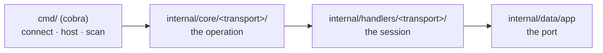

<p align="center">
  
</p>

<h1 align="center">
  cthrone
</h1>

<p align="center">A terminal chat tool that carries messages from one device to another, over a websocket or a NATS server.</p>

<p align="center">
  <a href="https://github.com/fiwon123/cthrone/actions/workflows/ci.go.yml"></a>
  
  <a href="https://github.com/fiwon123/cthrone/blob/main/LICENSE"></a>
</p>

---

## Table of contents

- [About](#about)
- [Security](#security)
- [How to use](#how-to-use)
- [Install](#install)
- [Commands](#commands)
- [Architecture](#architecture)
- [Repository](#repository)
- [How to develop](#how-to-develop)
- [Troubleshooting](#troubleshooting)
- [Tech stack](#tech-stack)
- [License](#license)

## About

cthrone is a chat tool for the terminal. One device hosts a chat server, another
connects to it, and the two exchange messages in the terminal — no account, no
GUI, no configuration file.

There are two transports, and the command set is the same either way:

- **websocket** (the default) — one device runs the server, the other connects
  to it over the local network. Nothing else needs to be installed.
- **NATS** — both sides talk to a broker, so the two devices do not need to
  see each other directly. Useful when a broker is already running.

There is nothing to configure: the only setting is the port, and it comes from
the command line. The `ct` short alias ships next to the `cthrone` binary,
because a name you type many times a day should be short.

**Supported platforms**: Windows, Linux, and Android (arm64).

> **Security**: the websocket transport requires a **shared secret** — a
> client that does not know it is refused — and it can be **encrypted** with
> `--tls`, which pins the host's certificate. Without `--tls` the messages
> travel in plaintext: use it on a network you trust. The NATS transport
> sends the broker's credentials and can encrypt the connection the same
> way. See
> [Security](#security) for how it is set up, and
> [issue #11](https://github.com/fiwon123/cthrone/issues/11) for the rest of
> the work.

> **Status**: actively used, pre-1.0, and not yet covered by tests — see
> [How to develop](#how-to-develop).

## Security

The websocket transport needs a **shared secret**: a client that does not
present it is refused with a `401` before any session starts. The secret is
read from the first of these that has a value:

| Source | How |
|---|---|
| `--token` | the flag — **visible in the process list** to every other process on the machine, so it is for a quick manual run, not for daily use |
| `CTHRONE_TOKEN` | the environment — the one to use in a container or a script |
| the token file | `--token-file <path>`, or `~/.config/cthrone/token` by default |

The host **generates** a secret the first time it runs and writes it to the
token file with `0600` — a secret every process on the machine can read is
not a secret. It is never replaced afterwards, so two devices that share the
file keep agreeing.

Two flags change the shape of it:

- `--host <address>` binds the server to one interface instead of every
  interface. The default is every interface, because the tool is a chat
  between two devices on the same network.
- `--allow-anonymous` on the host lets clients in without the secret. It is
  opt-in, it prints a warning, and it is how the tool behaved before the
  secret existed.

### Encryption

`--tls` encrypts the transport: the host serves `https`, and the client
connects over `wss://`.

The host's certificate is **self-signed** — there is no certificate
authority for a chat between two devices on a LAN. So the client does not
check it against an authority; it checks it against the **fingerprint** the
host prints:

```bash
cthrone host --tls
# Its fingerprint is c56e6a600a2398c7f13f14501e85508b9fe42ba050d5f0282c3653ed411821d9
```

Give that fingerprint to the other device:

```bash
cthrone connect 192.168.0.42 --tls --cert-fingerprint c56e6a600a2398c7f13f14501e85508b9fe42ba050d5f0282c3653ed411821d9
```

A certificate that does not match is refused, and the client says what it
got. The fingerprint is accepted with or without colons in it.

The host generates the certificate the first time it runs and keeps it —
`~/.config/cthrone/cert.pem` and `~/.config/cthrone/key.pem` (the key is
`0600`) — so the fingerprint does not change under a client that pinned it.

`--insecure` makes the client accept **any** certificate. The traffic is
still encrypted; the host is simply not checked, which means anyone who can
intercept the connection can present their own. It is for a trusted network,
and it has to be asked for.

Without `--tls` the messages travel in plaintext: the secret decides who may
join, it does not hide what is said.

## How to use

1. Install the binary (see [Install](#install)), or run it from source with
   `go run ./ --help`.

2. On the device that receives the messages, start the chat server:

   ```bash
   cthrone host
   ```

   It listens on port 8080 and prints a line when a client connects. The
   first time it runs, it also **generates a shared secret** and writes it to
   `~/.config/cthrone/token` (0600) — the path is printed. Keep it: the
   other device needs the same secret.

3. On the other device, connect to it:

   ```bash
   cthrone connect 192.168.0.42
   ```

   The IP is the address of the machine running `host`. Everything you type is
   sent; everything the other side types is printed.

   The client needs the same secret. Copy the file from the host device, or
   put the value in the environment:

   ```bash
   CTHRONE_TOKEN="$(cat ~/.config/cthrone/token)" cthrone connect 192.168.0.42
   ```

   On a network you do not trust, add `--tls` on both sides and give the
   client the fingerprint the host printed — see [Security](#security).

4. Do not know the address? Scan the local subnet for a chat server:

   ```bash
   cthrone scan
   ```

   It walks your /24 and prints the addresses that answer on the chat port.

5. Prefer a broker? Add `--nats` to either side, and run a NATS server
   locally — the repository ships one in `docker-compose.yml` for that:

   ```bash
   docker compose up -d nats
   cthrone host --nats
   ```

   The broker is published on `nats://127.0.0.1:4222` on the host, so a
   client running on the host reaches it. If the dev sandbox is already
   running, the broker is up with it — the sandbox declares the broker as
   a dependency, so `make dev-up` starts both.

   On the other side, `cthrone connect --nats` publishes to the broker.

   Note that on the NATS path the roles are inverted: `host` **subscribes** to
   the subject and `connect` **publishes** to it. The subject is the
   positional argument and defaults to `chat`:

   ```bash
   cthrone host --nats room-42
   cthrone connect --nats room-42
   ```

   The broker is the one the `--nats-url` flag names, and it defaults to
   `nats://127.0.0.1:4222` — so a remote broker is reachable:

   ```bash
   cthrone host --nats --nats-url nats://broker.internal:4222
   ```

   **The broker asks for credentials.** They come from the environment —
   `NATS_USER` and `NATS_PASSWORD` — and not from a flag, because a flag is
   visible in the process list:

   ```bash
   export NATS_USER=cthrone NATS_PASSWORD=cthrone-dev
   cthrone connect --nats
   ```

   The broker that ships with the dev sandbox uses the same names, with
   `cthrone` and `cthrone-dev` as the defaults. Override them for both
   sides when you want a different password:

   ```bash
   NATS_USER=cthrone NATS_PASSWORD=another-one docker compose up -d nats
   ```

   A broker that asks for no credentials is still reachable: without
   `NATS_USER` the client offers none.

   **The broker keeps nothing.** JetStream is off, so a conversation does
   not outlive the session it happened in, and the broker has no messages
   to clean up.

   **The connection to the broker can be encrypted** the same way the
   websocket one is: give the URL the `tls://` scheme and pin the
   broker's certificate.

   ```bash
   cthrone connect --nats --nats-url tls://broker.internal:4222 \
     --cert-fingerprint 1f2e3d...
   ```

## Install

Download the archive for your platform from the
[releases page](https://github.com/fiwon123/cthrone/releases), then run the
installer it ships with:

| Platform | Archive | Install |
|---|---|---|
| Linux | `*.tar.gz` | `tar -xzf <archive> && cd <folder> && ./add_to_path.sh` |
| Windows | `*.zip` | `Expand-Archive <archive>` then `.\add_to_path.bat` |
| Android | `*.zip` / `*.tar.gz` | unpack it, then run `./cthrone` (arm64) |

Each archive carries both `cthrone` and the short alias `ct`, so `ct host`
works the moment the folder is on your PATH.

## Commands

| Command | What it does |
|---|---|
| `cthrone host` | host the chat server and wait for a client |
| `cthrone connect <ip>` | connect to a device's chat server and chat |
| `cthrone scan` | scan the local subnet for chat servers (shows device names when discovered) |
| `cthrone ui` | launch the Fyne GUI (desktop; build with `-tags gui` and required system libraries) |
| `cthrone recv` | opt-in remote command receiver with allowlist and audit logging |
| `cthrone exec <device> -- <cmd>` | run a command via an opt-in receiver (allowlist + logging enforced) |

| Flag | What it does |
|---|---|
| `-p`, `--port` | the port to use (default `8080`) |
| `--nats` | use the NATS transport instead of the websocket one |
| `--nats-url` | the NATS broker to connect to (default `nats://127.0.0.1:4222`); a `tls://` URL asks for an encrypted connection |
| `--token` | the shared secret — **visible in the process list**, so prefer the environment or the file |
| `--token-file` | the file the shared secret is read from (default `~/.config/cthrone/token`) |
| `--host` | the interface `cthrone host` binds to (default: every interface) |
| `--allow-anonymous` | let clients join without the shared secret |
| `--name` | device name announced on the network (stored in `~/.config/cthrone/device.json`) |
| `--tls` | encrypt the transport: the host serves https, the client expects it |
| `--cert-fingerprint` | the fingerprint of the certificate to pin, with `--tls` |
| `--insecure` | accept any certificate, with `--tls` |
| `-v`, `--version` | print the version |

`cthrone connect` needs the address of the machine running `cthrone host`; it
exits with an error when it is not given one. Run `cthrone <command> --help`
for the full flag list.

## Architecture

The transport is chosen at the command level, and both transports meet at the
same chat loop, so they are interchangeable from your side.

The shared secret lives in `internal/auth` — it is not part of either
transport, because the credential is a property of the tool rather than of
the wire it uses.



`internal/core` decides *what* to do — connect, host, scan. The handlers
decide *how* the transport does it.

## Repository

- **Source**: https://github.com/fiwon123/cthrone
- **Releases**: https://github.com/fiwon123/cthrone/releases
- **Issues & discussions**: https://github.com/fiwon123/cthrone/issues
- **Wiki**: https://github.com/fiwon123/cthrone/wiki

## How to develop

### Prerequisites

Either of these works:

- **Host toolchain** — Go 1.25.5 or newer (the version is pinned in `go.mod`)
  and `make`. Fastest for a quick edit.
- **Dev sandbox** — Docker, and nothing else. The container pins Go 1.25.5, so
  your build is the build CI runs.

OpenCode is optional — see `AGENTS.md` for how the agent layer is configured.

### Quick start

```bash
git clone https://github.com/fiwon123/cthrone.git
cd cthrone
go run ./ --help
```

### Commands

| Command | What it does |
|---|---|
| `make check` | gofmt, vet, test, build — the local gate |
| `make release` | build the Windows and Linux archives and the Android binary into `build/` |
| `make clean` | remove `build/` |
| `go test ./...` | tests only |
| `gofmt -l .` | list files that are not formatted |
| `make help` | every target, with a one-line description |

### Dev sandbox

A container with the pinned toolchain, so the build is the same on a Linux
box, a Mac, a WSL2 shell and a Windows machine. Docker is the only
prerequisite — no Make, no Python, no host setup:

```bash
docker compose up           # the sandbox, with the broker it talks to
docker compose up -d nats   # just the broker, on nats://127.0.0.1:4222
```

The sandbox declares the broker as a dependency, so every way of starting
it — `docker compose up`, `make dev-up`, `scripts/dev-up.py dev-up` —
brings the broker up with it. The second command is for running only the
broker, e.g. against a host-side client.

With `make` (Linux, macOS, WSL2):

| Command | What it does |
|---|---|
| `make dev-up` | start the sandbox in the foreground |
| `make dev-shell` | open a shell inside it |
| `make dev-opencode` | run the AI agent inside it (Linux/WSL2 only) |
| `make dev-down` | stop it |
| `make dev-build` | rebuild the image after a `Dockerfile` change |
| `make reset` | stop everything and wipe the volumes |

On native Windows, where `make` does not exist:

```powershell
python scripts\dev-up.py dev-up
```

From inside the sandbox the broker is at `nats://nats:4222` (the compose
service name); from the host it is `nats://127.0.0.1:4222`. The broker's host
ports are overridable — `NATS_PORT=4223 docker compose up -d nats` — so two
sandboxes can run at once.

The agent overlay (`docker-compose.agent.yml`) is merged automatically when the
host has a **Linux** opencode binary — the container is Linux, so a macOS or
Windows binary cannot execute inside it. The overlay mounts the gh config, the
opencode binary and `~/.gitconfig` read-only. No Docker socket is mounted: the
agent inside the sandbox cannot manage containers.

### A note on what `make check` proves

`make check` runs gofmt, vet, test, and build. **This repository has no test
files at all**: `go test ./...` prints `[no test files]` for every package and
still exits 0.

A green run therefore proves exactly three things — the code is formatted, it
vets clean, and it compiles. It does **not** prove the behaviour works, and
for a chat tool the behaviour is the whole point: that a message arrives, that
a host binds the right port, that a scan finds the server. `make check` prints
the list of uncovered packages after the run so the gap is visible in the
output, not only in this paragraph.

## Troubleshooting

### `cthrone: command not found`

The installer's job is to add the extracted folder to your PATH. On Linux it
appends to `~/.bashrc`; start a new shell, or source the file by hand:

```bash
source ~/.bashrc
```

### `connect` says nothing and returns immediately

The websocket client reports what went wrong when it cannot reach the server.
Check that `cthrone host` is running on the other device, that the address is
right, and that the port matches — `cthrone scan` on the same network lists
the servers it can find.

An address that already carries a port is used as it is:
`cthrone connect 192.168.0.42:9000` talks to port 9000 and not to the
`--port` flag.

### The client says the host refused the connection

- **"it needs the shared secret"** — the two devices do not have the same
  secret. Copy `~/.config/cthrone/token` from the host, or set
  `CTHRONE_TOKEN` to the same value on both sides.
- **"it is serving TLS, add --tls"** — the host was started with `--tls` and
  the client was not. Add `--tls` to the client, and give it the
  `--cert-fingerprint` the host printed.
- **"the certificate of the host does not match the fingerprint"** — the
  client pinned a different certificate. The host generates one the first
  time it runs and keeps it, so this means the client has an old
  fingerprint, or it is talking to a different host.

### `scan` finds nothing

`scan` walks your own /24 and dials the chat port on every address. It finds
nothing when the server is on a different subnet, when a firewall blocks the
port, or when the server is on the other side of a NAT.

### The broker says "Authorization Violation"

The broker asks for credentials and the client offered none, or the wrong
ones. Set them on both sides — the client reads `NATS_USER` and
`NATS_PASSWORD` from the environment:

```bash
export NATS_USER=cthrone NATS_PASSWORD=cthrone-dev
```

The dev broker uses the same names, with `cthrone` and `cthrone-dev` as
the defaults, so the two sides agree without anyone exporting anything —
as long as the password has no `#` or quote in it, which the broker's
configuration parser does not carry through.

### The NATS path cannot reach a remote broker

The broker is the one `--nats-url` names, and it defaults to
`nats://127.0.0.1:4222`. If a remote broker is not reachable, check the URL
first: the flag takes the whole address, including the scheme and the port.

### The sandbox dies with `set: pipefail: invalid option name`

The bind mount serves your working tree as-is, and a checkout that predates the
`.gitattributes` rule keeps CRLF line endings — which `git status` does not
show, because git compares normalized content. Re-check the tree out with LF
endings:

```bash
git rm --cached -r . >/dev/null && git reset --hard
```

### The sandbox refuses to start as UID 0

`make` refuses to run the container as root, because a root-owned bind mount
makes every file in the repository unwritable by your own user. Repair the
ownership of the checkout, or point the sandbox at your own identity:

```bash
HOST_UID="$(id -u)" HOST_GID="$(id -g)" make dev-up
```

### `make dev-opencode` says the agent needs a Linux binary

The container is Linux, so a macOS or Windows opencode install cannot execute
inside it. Use WSL2 — where the host binary is Linux — or run opencode on the
host against the running stack.

### The sandbox fails with `EACCES: permission denied, mkdir '/home/devuser/.cache/opencode'`, or `mkdir /go/pkg/mod/cache: permission denied`

The sandbox's caches are Docker volumes, and Docker creates a mount destination
the image does not contain **as root** — while the container runs as your UID.
The image now creates those directories itself, so a sandbox built from the
current `Dockerfile` is fine.

A sandbox created **before** that fix keeps its old, root-owned volumes:
Docker does not re-initialise a volume that already exists. Recreate them
once:

```bash
make reset        # docker compose down -v
make dev-up
```

### The broker port is already taken

Another NATS server (or another sandbox) already owns port 4222. Move this one:

```bash
NATS_PORT=4223 NATS_MONITOR_PORT=8223 docker compose up -d nats
```

## Tech stack

| Layer | Technology |
|---|---|
| Language | Go 1.25.5 |
| CLI | spf13/cobra |
| Transports | gorilla/websocket, nats-io/nats.go |
| Terminal | golang.org/x/term |

## License

MIT — see [LICENSE](LICENSE). The Apache-2.0 dependencies are attributed in
[NOTICE](NOTICE), and their licence text ships in
[LICENSE-APACHE](LICENSE-APACHE).
