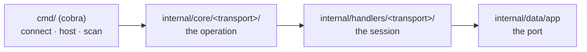

<h1 align="center">
  cthrone
</h1>

<p align="center">A terminal chat tool that carries messages from one device to another, over a websocket or a NATS server.</p>

<p align="center">
  <a href="https://github.com/fiwon123/cthrone/actions/workflows/ci.go.yml"></a>
  
  <a href="https://github.com/fiwon123/cthrone/blob/main/LICENSE"></a>
</p>

---

## Table of contents

- [About](#about)
- [How to use](#how-to-use)
- [Install](#install)
- [Commands](#commands)
- [Architecture](#architecture)
- [Repository](#repository)
- [How to develop](#how-to-develop)
- [Troubleshooting](#troubleshooting)
- [Tech stack](#tech-stack)
- [License](#license)

## About

cthrone is a chat tool for the terminal. One device hosts a chat server, another
connects to it, and the two exchange messages in the terminal — no account, no
GUI, no configuration file.

There are two transports, and the command set is the same either way:

- **websocket** (the default) — one device runs the server, the other connects
  to it over the local network. Nothing else needs to be installed.
- **NATS** — both sides talk to a broker, so the two devices do not need to
  see each other directly. Useful when a broker is already running.

There is nothing to configure: the only setting is the port, and it comes from
the command line. The `ct` short alias ships next to the `cthrone` binary,
because a name you type many times a day should be short.

**Supported platforms**: Windows, Linux, and Android (arm64).

> **Security**: the transports are currently **open and unencrypted**. The
> websocket server accepts any client that can reach the port, and messages
> travel in plaintext. Use it on a network you trust, and see
> [issue #11](https://github.com/fiwon123/cthrone/issues/11) for the work that
> would change that.

> **Status**: actively used, pre-1.0, and not yet covered by tests — see
> [How to develop](#how-to-develop).

## How to use

1. Install the binary (see [Install](#install)), or run it from source with
   `go run ./ --help`.

2. On the device that receives the messages, start the chat server:

   ```bash
   cthrone host
   ```

   It listens on port 8080 and prints a line when a client connects.

3. On the other device, connect to it:

   ```bash
   cthrone connect 192.168.0.42
   ```

   The IP is the address of the machine running `host`. Everything you type is
   sent; everything the other side types is printed.

4. Do not know the address? Scan the local subnet for a chat server:

   ```bash
   cthrone scan
   ```

   It walks your /24 and prints the addresses that answer on the chat port.

5. Prefer a broker? Add `--nats` to either side, and run a NATS server
   locally — the repository ships a `docker-compose.yaml` for that:

   ```bash
   docker compose up -d
   cthrone host --nats
   ```

   On the other side, `cthrone connect --nats` publishes to the broker.

   Note that on the NATS path the roles are inverted: `host` **subscribes** to
   the subject and `connect` **publishes** to it. The subject defaults to
   `chat`, and the value of `--nats` is currently used as the subject rather
   than as a broker URL — see
   [issue #12](https://github.com/fiwon123/cthrone/issues/12).

## Install

Download the archive for your platform from the
[releases page](https://github.com/fiwon123/cthrone/releases), then run the
installer it ships with:

| Platform | Archive | Install |
|---|---|---|
| Linux | `*.tar.gz` | `tar -xzf <archive> && cd <folder> && ./add_to_path.sh` |
| Windows | `*.zip` | `Expand-Archive <archive>` then `.\add_to_path.bat` |
| Android | `*.zip` / `*.tar.gz` | unpack it, then run `./cthrone` (arm64) |

Each archive carries both `cthrone` and the short alias `ct`, so `ct host`
works the moment the folder is on your PATH.

## Commands

| Command | What it does |
|---|---|
| `cthrone host` | host the chat server and wait for a client |
| `cthrone connect <ip>` | connect to a device's chat server and chat |
| `cthrone scan` | scan the local subnet for chat servers |

| Flag | What it does |
|---|---|
| `-p`, `--port` | the port to use (default `8080`) |
| `--nats` | use the NATS transport instead of the websocket one |
| `-v`, `--version` | print the version |

`cthrone connect` needs the address of the machine running `cthrone host`; it
exits with an error when it is not given one. Run `cthrone <command> --help`
for the full flag list.

## Architecture

The transport is chosen at the command level, and both transports meet at the
same chat loop, so they are interchangeable from your side.



`internal/core` decides *what* to do — connect, host, scan. The handlers
decide *how* the transport does it.

## Repository

- **Source**: https://github.com/fiwon123/cthrone
- **Releases**: https://github.com/fiwon123/cthrone/releases
- **Issues & discussions**: https://github.com/fiwon123/cthrone/issues
- **Wiki**: https://github.com/fiwon123/cthrone/wiki

## How to develop

### Prerequisites

- Go 1.25.5 or newer (the version is pinned in `go.mod`)
- `make`
- OpenCode — see `AGENTS.md` for how the agent layer is configured

### Quick start

```bash
git clone https://github.com/fiwon123/cthrone.git
cd cthrone
go run ./ --help
```

### Commands

| Command | What it does |
|---|---|
| `make check` | gofmt, vet, test, build — the local gate |
| `make release` | build the Windows and Linux archives and the Android binary into `build/` |
| `make clean` | remove `build/` |
| `go test ./...` | tests only |
| `gofmt -l .` | list files that are not formatted |

### A note on what `make check` proves

`make check` runs gofmt, vet, test, and build. **This repository has no test
files at all**: `go test ./...` prints `[no test files]` for every package and
still exits 0.

A green run therefore proves exactly three things — the code is formatted, it
vets clean, and it compiles. It does **not** prove the behaviour works, and
for a chat tool the behaviour is the whole point: that a message arrives, that
a host binds the right port, that a scan finds the server. `make check` prints
the list of uncovered packages after the run so the gap is visible in the
output, not only in this paragraph.

## Troubleshooting

### `cthrone: command not found`

The installer's job is to add the extracted folder to your PATH. On Linux it
appends to `~/.bashrc`; start a new shell, or source the file by hand:

```bash
source ~/.bashrc
```

### `connect` says nothing and returns immediately

The websocket client gives up if the server does not answer. Check that
`cthrone host` is running on the other device, that the address is right, and
that the port matches — `cthrone scan` on the same network lists the servers
it can find.

### `scan` finds nothing

`scan` walks your own /24 and dials the chat port on every address. It finds
nothing when the server is on a different subnet, when a firewall blocks the
port, or when the server is on the other side of a NAT.

### The NATS path cannot reach a remote broker

The broker URL is currently hardcoded to the default
(`nats://127.0.0.1:4222`), and the value of `--nats` is used as the subject
instead. See [issue #12](https://github.com/fiwon123/cthrone/issues/12).

## Tech stack

| Layer | Technology |
|---|---|
| Language | Go 1.25.5 |
| CLI | spf13/cobra |
| Transports | gorilla/websocket, nats-io/nats.go |
| Terminal | golang.org/x/term |

## License

MIT — see [LICENSE](LICENSE). The Apache-2.0 dependencies are attributed in
[NOTICE](NOTICE), and their licence text ships in
[LICENSE-APACHE](LICENSE-APACHE).
