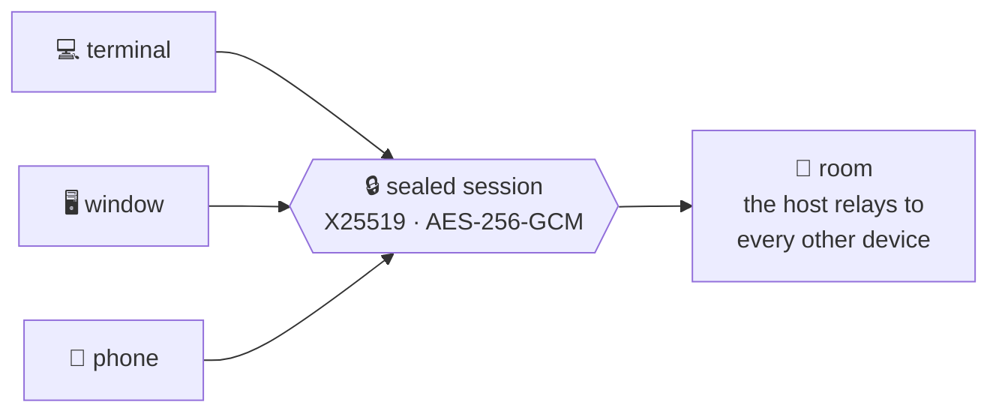

<div align="center">

# 💬 cthrone

**Chat from one device to another** — terminal, desktop window, or phone.<br>
No account, no server, no cloud. One device hosts, the others connect, and every
session is sealed end to end.


</div>

---

## 🚀 Start in thirty seconds

```bash
# on the device that serves
cthrone host

# on the other one, with the address the host printed
cthrone connect 192.168.1.5
```

Both screens show a **six-digit code** the first time — 👀 compare them, accept
on the host, and type. That is the whole setup.

> 🖥️ Prefer a window? Run `cthrone_gui`, or `cthrone ui` from the CLI build.
> 📱 On a phone, install the APK and use the Setup tab.

## 🗺️ How it fits together



The transport is a flag — **websocket** (default), **NATS** (a broker) or
**Bluetooth** (no network at all). Everything above it is the same code, so the
chat behaves the same whichever you pick.

## 🎯 Pick your path

| I want to… | Go here |
|---|---|
| 💬 **chat right now** | [Host and connect](Host-and-connect) — two commands |
| ✂️ **copy, delete or hide a message** | [Working with messages](Working-with-messages) |
| 🔑 **understand the code both screens show** | [Pairing and peers](Pairing-and-peers) |
| 📎 **send a picture, a file or a voice note** | [Send a file](Send-a-file) |
| 🎞️ **play a GIF or a video** | [Video in the app](Video-in-the-app) |
| 📶 **chat with no network at all** | [Bluetooth](Bluetooth) |
| 🛰️ **chat across two networks** | [NATS](NATS) · [Across networks](Finding-devices-across-networks) |
| 🚑 **fix something** | [Troubleshooting](Troubleshooting) |
| 🔒 **know what is protected** | [Security model](Security-model) |
| 🧪 **help prove what is unproven** | [Verifying on real hardware](Verifying-on-real-hardware) |
| 🛠️ **build or change it** | [Development](Development) |

## 📊 What works, where

| | Terminal | Window | Phone |
|---|:---:|:---:|:---:|
| **websocket** (default) | ✅ | ✅ | ✅ |
| **NATS** (needs a broker) | ✅ | ✅ | ✅ |
| **Bluetooth** (no network) | ✅ Linux | ✅ Linux | ❌ not yet ([#206](https://github.com/fiwon123/cthrone/issues/206)) |
| **files** | ❌ text only | ✅ | ✅ |
| **audio (WAV/MP3)** | ❌ | ✅ | ✅ |
| **animated GIF** | ❌ | ✅ | ✅ |
| **video (MP4/H.264)** | ❌ | ❌ needs a codec ([#389](https://github.com/fiwon123/cthrone/issues/389)) | ❌ |

## 🧪 What is proven, and what is not

This project says what it verified. ❌ means *nobody has run it*, not *it is
broken*:

| Claim | State |
|---|---|
| the app, the transports and the security model | ✅ tested on every change |
| audio (WAV/MP3) with a waveform and a seek bar | ⚠️ tested, not **heard** on a phone |
| an animated GIF playing in its row | ⚠️ tested, not seen on a phone |
| the **Bluetooth radio on Windows** | ❌ [#224](https://github.com/fiwon123/cthrone/issues/224) |
| the **phone app** on a device, and its radio | ❌ [#155](https://github.com/fiwon123/cthrone/issues/155), [#206](https://github.com/fiwon123/cthrone/issues/206) |
| **video (MP4/H.264)** | ❌ needs a codec — [#389](https://github.com/fiwon123/cthrone/issues/389) |

If you own one of the ❌ rows, **[Verifying on real hardware](Verifying-on-real-hardware)**
has the steps and the issue to report on. "It worked" is an answer.

---

<sub>📦 [Releases](https://github.com/fiwon123/cthrone/releases) ·
🐛 [Issues](https://github.com/fiwon123/cthrone/issues) ·
🗺️ [Roadmap board](https://github.com/users/fiwon123/projects/7) ·
🤝 [Contributing](https://github.com/fiwon123/cthrone/blob/dev/CONTRIBUTING.md)</sub>
