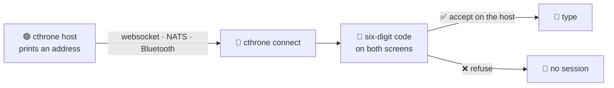

# Host and connect

## 🚦 The icon in the chat header

One glyph and one word, always there, so you never have to open Setup to know
where you stand:

| | | |
|---|---|---|
| ⚪ | **offline** | nothing running |
| 🟡 | **starting** | a host or a connect is being opened |
| 🟢 | **hosting** | this window is serving a room |
| 🔵 | **connected** | a client, with its device |
| 🟠 | **reconnecting** | the link dropped and it is trying again |
| 🔴 | **lost** | the link went away and nothing is retrying |

The transcript still says *what* happened ("Disconnected: …", "Paired with …");
the header says *where you stand now*, and a line above the message box carries
anything the app needs to say — tap it to copy it. A red icon is worth a look at
**Stop**: pressing it and hosting again is the fastest reset.

## ⚡ In a hurry

```bash
cthrone host                 # on the device that serves (port 8080)
cthrone connect 192.168.1.5  # on the other one
```

The host prints its address. Compare the six-digit code on both screens, accept
on the host, and type.



The default transport needs nothing but the two binaries: one device hosts, the
other connects.

## On the device that hosts

```bash
cthrone host
```

It serves on port **8080** on every interface, over `https`/`wss` by default.
Useful flags:

| Flag | What it does |
|---|---|
| `-p`, `--port` | the port (default `8080`) |
| `--host` | bind one interface instead of every one |
| `--name` | the device name the peer sees, and the name a scan reports |
| `--no-tls` | plaintext `ws://` — only for a v0.6.0 peer or a network you trust |

A host is a **room**: every device that joins sees the messages of every other,
with the sender named. There is no pairing of two devices in private.

## On the device that connects

```bash
cthrone connect 192.168.1.20
```

or, if you scanned first, the address the scan printed. The client dials `wss://`
and pins the host's self-signed certificate on first contact.

## What happens on first contact

1. Both screens show a **six-digit code**, derived from the two ephemeral keys.
2. The **host asks** whether to accept the device; the code is what you compare.
3. Answer **Accept**, and the device's key is pinned under its name. Answer
   **Refuse** — or let the question expire — and nothing is recorded.

The code is the whole defence against a machine in the middle, and it only
works if the two numbers match. [Pairing and peers](Pairing-and-peers) covers
what is stored and how to undo it.

## Finding the host

```bash
cthrone scan              # walks the /24 the default route uses
cthrone scan --subnet 192.168.1.0/24
cthrone scan --all-subnets
```

A scan reports devices that announce themselves and hosts that answer on the
chat port. It cannot cross a subnet, a NAT or a router that isolates its
clients — a device on another Wi-Fi of the same modem is found after it has been
connected to once, because the host then also announces itself to that address
by unicast. See
[Finding devices across networks](Finding-devices-across-networks), and
[NATS](NATS) when the network isolates its own clients.

---

<sub>🏠 **Previous:** [Home](Home) · 🏠 [Home](Home) · **Next:** [Pairing and peers](Pairing-and-peers) 🔑</sub>
