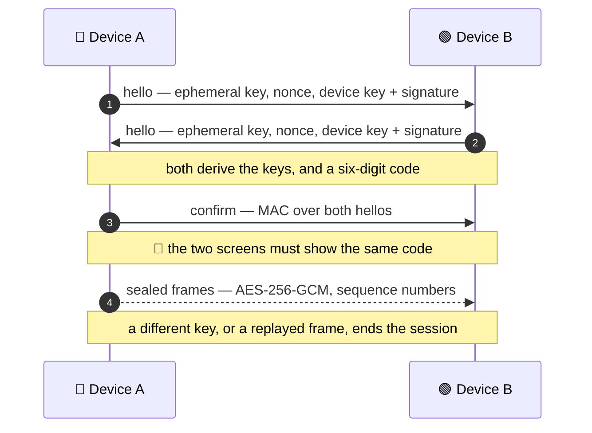

# Security model

## ⚡ In a hurry

| | |
|---|---|
| ✅ **Every session is sealed** — X25519, HKDF per direction, AES-256-GCM, replay refused | no plaintext mode |
| ✅ **Every peer proves a key** — this device's ed25519 key, or a shared secret | a stranger cannot join |
| ✅ **wss:// by default** — the host's certificate pinned on first contact | `--no-tls` opts out |
| ⚠️ **The shape stays visible** — who talks when, and to which subject or address | encryption is not anonymity |

The short version. The long one, with the issues that decided it (#11, #109,
#125, #124, #202), is in the README's Security section.

## One credential, chosen once

| When | Credential |
|---|---|
| no secret configured (the default) | this device's ed25519 key, pinned by the peer on first contact |
| `--token`, `CTHRONE_TOKEN` or `--token-file` | the shared secret — the v0.6.0 path |

The choice is made once, in `internal/pairing`, so the transports cannot
disagree. A peer speaking the other model is refused, never downgraded.

## Every session is sealed

X25519, HKDF per direction, AES-256-GCM, and a sequence number that fails a
replayed frame. There is no plaintext or anonymous mode, on any transport —
including Bluetooth, whatever the radio's own pairing does.

## First contact is the only moment to insert a machine

Which is why it is the moment that shows a **six-digit code** on both screens,
and why a pin is only as good as the comparison of those numbers. Each screen
prints both fingerprints as well, so the two values that have to agree are on
both screens at once.

## What stays visible

- On a websocket: the address, and the frame sizes and timing.
- On NATS: the subject, and the timing. Not the payload.
- On a radio: packet counts and timing. Not the payload.
- With `--no-tls`: the websocket's shape goes back onto the wire, but the
  payload stays sealed.

## Things this program will not do

- Store or print a secret or a key.
- Accept a credential on a flag and put it in a log (a flag value is visible in
  the process list, which is why the environment or a file is preferred).
- Re-pin a name or an address that changed. `cthrone peers forget` is the way
  back, and it is deliberately manual.

---

🚑 **Previous:** [Troubleshooting](Troubleshooting) · 🏠 [Home](Home) · **Next:** [Verifying on real hardware](Verifying-on-real-hardware) 🧪
